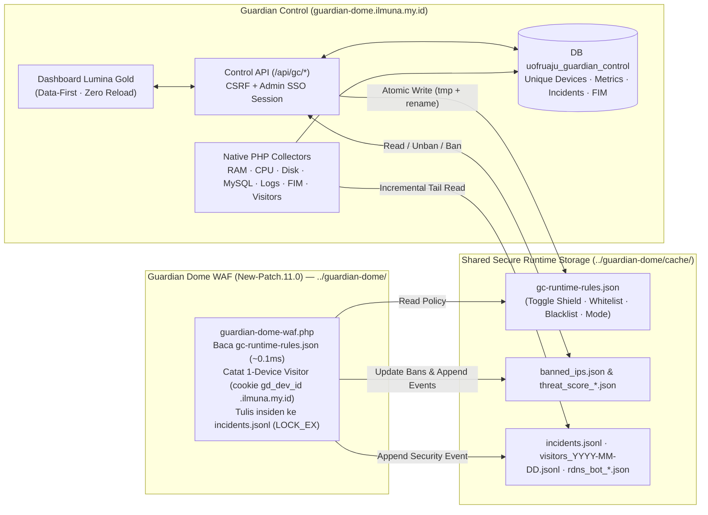

# 🏛️ GUARDIAN CONTROL — MASTER ARCHITECTURAL BLUEPRINT

> **Dokumen Arsitektur Teknis Lengkap untuk `https://guardian-dome.ilmuna.my.id`**  
> **Lokasi Engine WAF:** `realpath(__DIR__ . '/../guardian-dome')` (cPanel `/home/uofruaju/guardian-dome`, fallback lokal `C:\laragon\Guardian Dome`)  
> **Standar:** 100% Lumina Gold & Nusantara · PHP 7.4–8.3 Native · MySQL InnoDB (`utf8mb4`) · cPanel-Safe Native Telemetry · Terintegrasi Penuh dengan **Guardian Dome WAF (`New-Patch.11.0`)**, **Margo One SSO**, & **Unique Device Analytics Lintas Semua Web `*.ilmuna.my.id`**

---

## 1. ARSITEKTUR SISTEM & JEMBATAN WAF ZERO-OVERHEAD

Agar Guardian Control dapat mengendalikan **Guardian Dome WAF (`New-Patch.11.0`)** secara real-time **tanpa menambah koneksi MySQL di setiap request pengunjung** (menjaga performa mikrodetik di shared hosting cPanel), arsitektur menggunakan pola **Atomic File Policy Bridge**:



### Keunggulan Arsitektur Atomic Policy Bridge
1. **Zero Database Load di Sisi WAF**: `guardian-dome-waf.php` tetap super cepat (<1 ms) karena hanya membaca 1 file JSON lokal (`gc-runtime-rules.json`) dengan fallback konstanta bawaan jika file belum ada.
2. **Perubahan Instan Tanpa Edit Kode PHP**: Admin cukup klik saklar di Guardian Control (misal aktifkan *Under-Attack Mode*, tambah IP Whitelist, ubah ambang batas *Shield v3 Min Score*, atau unban IP), file `gc-runtime-rules.json` ditulis secara atomik (`file_put_contents` ke `.tmp` lalu `rename()`) dan langsung berlaku di `ilmuna.my.id`, `margo-one.ilmuna.my.id`, serta `learn.ilmuna.my.id`.
3. **Histori Jangka Panjang di MySQL**: File `incidents.jsonl` disinkronkan secara inkremental (on-demand / cron 5 menit) ke tabel `gc_incidents` di `uofruaju_guardian_control`, sehingga log tidak pernah membengkak di disk dan bisa difilter/dianalisis berbulan-bulan.

---

## 2. SPESIFIKASI 9 MODUL UTAMA

### Modul 0 — Unique Device Visitor Analytics (`1 Device = 1 Pengunjung` · Lintas Semua Web `*.ilmuna.my.id`) (`tab=visitors`)
Karena **Guardian Dome WAF (`../guardian-dome/guardian-dome-waf.php`)** berjalan otomatis di depan **seluruh web ekosistem `*.ilmuna.my.id` tanpa terkecuali** (`ilmuna.my.id`, `margo-one.ilmuna.my.id`, `learn.ilmuna.my.id`, `guardian-dome.ilmuna.my.id`, serta subdomain baru di masa depan), pencatatan pengunjung dilakukan terpusat di level WAF **tanpa perlu menanam script analitik manual di tiap aplikasi**:
- **Anti-Double-Count (1 Device = 1 Pengunjung)**:
  - Saat manusia membuka halaman HTML manapun di `*.ilmuna.my.id`, WAF menerbitkan cookie HTTP-only ringan lintas-subdomain **`gd_dev_id`** (`domain=.ilmuna.my.id`, masa aktif 365 hari, nilai acak kriptografis 16 byte hex).
  - `device_hash = SHA-256(gd_dev_id)` (atau fallback `SHA-256(ip_subnet_24 + '|' + ua_normalized + '|' + accept_lang)` bila kunjungan pertama sebelum cookie tersimpan).
  - Jika 1 HP/laptop me-refresh atau membuka 40 halaman dalam sehari:
    - **Unique Device** tetap terhitung **1** (`UNIQUE KEY (visit_date, domain, device_hash)`).
    - **Total Pageviews (`hits_count`)** dicatat di kolom terpisah agar admin tetap tahu kedalaman interaksi tanpa menggelembungkan jumlah pengunjung!
  - **Metrik Global Ekosistem vs Per-Web**:
    - **Unique Device Ekosistem Hari Ini / 7 Hari / 30 Hari**: `COUNT(DISTINCT device_hash)` lintas semua subdomain (1 device yang buka WordPress → Margo One → Learn tetap dihitung **1 perangkat unik ekosistem**!).
    - **Rincian Per Subdomain (Auto-Discover)**: Tabel & grafik otomatis menampilkan setiap host `*.ilmuna.my.id` yang aktif (`ilmuna.my.id`, `margo-one.ilmuna.my.id`, `learn.ilmuna.my.id`, dll.), jumlah **Unique Device**, **Online Aktif (5 menit terakhir)**, dan **Total Hits**.
    - **Breakdown Perangkat & Browser**: Android, iOS, Windows, macOS, Linux + Chrome, Safari, Edge, Firefox, Exam Browser.
- **100% Bebas Bot & Aset Statis**:
  - Melewati (tidak menghitung) seluruh crawler SEO (`is_official_bot`), bot AI (`GPTBot`, `ClaudeBot`, dll.), bot preview media sosial, request aset statis (`.css`/`.js`/gambar), `POST`, `/api/`, `wp-cron.php`, dan `admin-ajax.php`.
- **Zero Overhead di Request Pengunjung**:
  - WAF menulis event ringan 1 baris ke `../guardian-dome/cache/visitors_YYYY-MM-DD.jsonl` (atau deduplikasi in-memory per hari via file map ringan), lalu `cron/collect-telemetry.php` & tombol Segarkan melakukan `INSERT ... ON DUPLICATE KEY UPDATE hits_count = hits_count + VALUES(hits_count), last_seen_at = GREATEST(...)` ke tabel `gc_unique_visitors`.

### Modul 1 — WAF Command Center & Policy Switchboard (`tab=waf`)
- **Status Engine Aktif**: Menampilkan versi aktif Guardian Dome (`New-Patch.11.0`), status Shield v3, status FCrDNS SEO/AdSense, jumlah IP terblokir, dan status 3 subdomain (`ilmuna.my.id`, `margo-one.ilmuna.my.id`, `learn.ilmuna.my.id`).
- **Saklar Kendali Real-Time (`gc-runtime-rules.json`)**:
  - `under_attack_mode` (bool): Memaksa layar Pre-Flight Scan + pengetatan rate-limit seketika saat terjadi lonjakan DDoS.
  - `enable_preflight_scan` (bool): Aktif/nonaktifkan layar Pre-Flight Scan global.
  - `enable_shield_v3` (bool) & `shield_v3_min_score` (`0.20` – `0.70`, default `0.35`).
  - `enable_ai_scraper_block` (bool): Blokir ChatGPT/GPTBot, ClaudeBot, PerplexityBot, Bytespider, Google-Extended, dll.
  - `enable_honeypot_form` (bool): Jebakan form `_gd_hp_contact`.
  - `enable_seo_adsense_pass` (bool): Izinkan crawler terverifikasi FCrDNS (Googlebot, Site Kit, AdSense, Bingbot).
  - `rate_limit_burst` & `rate_limit_normal`: Pengaturan dinamis batas request per jendela waktu.
- **Tombol Darurat 1-Klik**: *Emergency Reset Semua Ban* & *Flush Cache FCrDNS* (terproteksi konfirmasi `Ilmuna.confirm()` + audit log).

### Modul 2 — IP Firewall, Subnet `/24` Isolation & Whitelist (`tab=firewall`)
- **Daftar IP Terblokir (Live)**: Membaca gabungan `banned_ips.json` (WAF cache) + `gc_ip_rules` (DB), menampilkan IP, Subnet `/24`, Ray-ID, Alasan Blokir, Target Subdomain, Waktu Ban, dan tombol **Unban 1-Klik**.
- **Manual Ban & Bulk Action**: Form tambah blokir IP tunggal atau CIDR `/24` dengan alasan & durasi (Permanen / 1 Jam / 24 Jam / 7 Hari), plus checkbox bulk unban / bulk promote-to-permanent.
- **Whitelist Manager**: Kelola daftar IP bebas false-positive (IP Admin, IP Sekolah/Kantor, IP Server) dengan label deskriptif dan tombol *"Tambahkan IP Saya Saat Ini"*.

### Modul 3 — Security Incident & Attack Log Explorer (`tab=incidents`)
- **Log Terstruktur** (diambil dari `incidents.jsonl` → `gc_incidents`):
  - Kategori filter cepat: `ALL`, `SQLi / XSS / LFI`, `RCE / Webshell`, `Anti-AI Scraper`, `Shield v3 / Honeypot`, `OOB / SSRF / JWT`, `Brute-Force / Stuffing`, `DNS / IP Spoof`, `Rate Limit / Flood`.
  - Filter berdasarkan **Subdomain**, **IP**, **Ray-ID**, dan **Rentang Tanggal** (menggunakan `includes/calendar-template.php`).
  - Modal detail payload lengkap (Method, URI, User-Agent, Origin/Referer, Skor Shield v3, Ray-ID) + tombol cepat **Ban IP** / **Whitelist IP**.
  - Ekspor laporan insiden ke **CSV** & **JSON**.

### Modul 4 — Deep Server Health & Grassroots Resource Telemetry (`tab=server`)
**100% Native PHP (Aman di Shared Hosting cPanel tanpa `exec()`) — Monitoring Sampai Akar Rumput:**
1. **RAM, Swap & PHP Memory Drill-Down**:
   - Linux cPanel: parsing lengkap `/proc/meminfo` (`MemTotal`, `MemAvailable`, `MemFree`, `Buffers`, `Cached`, `SwapTotal`, `SwapFree`) → persentase RAM & Swap terpakai akurat.
   - Windows Laragon (fallback dev): `memory_get_usage(true)`, `memory_get_peak_usage(true)`, `ini_get('memory_limit')`.
2. **CPU Load Average, Saturation & Process Queue**:
   - `sys_getloadavg()` (1m/5m/15m), jumlah core (`/proc/cpuinfo`), persentase saturasi per-core, serta antrean proses aktif dari `/proc/loadavg`.
3. **Disk, Storage Quota & Directory Drill-Down**:
   - `disk_total_space()` & `disk_free_space()` pada root home `/home/uofruaju` (atau `C:\laragon`), plus audit ukuran direktori utama (`guardian-dome/cache`, `uploads/`, `wp-content/uploads`, `error_log` tiap web) & peringatan file log raksasa (> 5 MB).
4. **PHP Runtime, `php.ini` Security Audit & OPcache Detail**:
   - Versi PHP (`PHP_VERSION`), SAPI, ekstensi kritis (`pdo_mysql`, `openssl`, `curl`, `mbstring`, `zip`, `gd`), audit konfigurasi keamanan (`display_errors`, `expose_php`, `allow_url_include`, `open_basedir`, `disable_functions`, `upload_max_filesize`, `max_execution_time`), serta statistik `opcache_get_status(false)` (hit rate %, memory used/free/wasted, cached scripts, oom restarts).
5. **MySQL / MariaDB Deep Health**:
   - `SHOW GLOBAL STATUS` (`Threads_connected`, `Threads_running`, `Max_used_connections`, `Uptime`, `Questions`, `Slow_queries`, `Aborted_connects`, `Table_locks_waited`).
   - **Live Query Inspector (`SHOW PROCESSLIST`)**: deteksi query lambat/stuck secara real-time.
   - **Per-Database & Top-Table Drill-Down (`INFORMATION_SCHEMA.TABLES`)**: ukuran (MB), jumlah baris, dan overhead fragmentasi tiap database & tabel terbesar di ekosistem.
6. **Subdomain HTTP Uptime, TTFB Latency, SSL & Security Headers Audit**:
   - Pengujian aktif via cURL ringan ke semua subdomain `*.ilmuna.my.id` (`ilmuna.my.id`, `margo-one.ilmuna.my.id`, `learn.ilmuna.my.id`, `/api/sso/jwks.php`, dll.) → mencatat HTTP status code, **TTFB & total latency (ms)**, **masa berlaku SSL (issuer + sisa hari)**, serta audit **HTTP Security Headers** (`HSTS`, `CSP`, `X-Frame-Options`, `X-Content-Type-Options`, `Referrer-Policy`).
7. **Cron & Background Job Heartbeat Monitor**:
   - Memantau waktu eksekusi terakhir `collect-telemetry.php` & `cache-purger` agar langsung memberi peringatan jika cron cPanel berhenti/terlambat.

### Modul 5 — Centralized Error Log & Crash Monitor (`tab=errors`)
- **Multi-App Log Tail Reader** (membaca 200KB terakhir secara efisien dengan `fseek()`, tidak pernah memuat file GB ke RAM!):
  - Target sumber konfigurabel di `config.php`:
    - `WordPress`: `/home/uofruaju/public_html/error_log` & `wp-content/debug.log`
    - `Margo One SSO`: `/home/uofruaju/margo-one.ilmuna.my.id/error_log`
    - `Ilmuna Learn`: `/home/uofruaju/learn.ilmuna.my.id/error_log`
    - `Guardian Dome`: `/home/uofruaju/guardian-dome/cache/php_errors.log`
- **Parsing & Klasifikasi Otomatis**:
  - Mengelompokkan baris log menjadi: `FATAL / PARSE`, `EXCEPTION`, `WARNING`, `NOTICE / DEPRECATED`, `MYSQL / PDO`.
  - Deduplikasi error berulang (menampilkan jumlah kemunculan + waktu terakhir terjadi).
  - Aksi aman: **Unduh Log**, **Arsipkan & Kosongkan Log (Truncate)** dengan konfirmasi `Ilmuna.confirm()`.

### Modul 6 — AI Scraper, Bot & SEO/AdSense Traffic Inspector (`tab=bots`)
- Statistik dan daftar terpisah antara:
  - **Blocked AI / LLM Scrapers**: GPTBot, ChatGPT-User, OAI-SearchBot, ClaudeBot, PerplexityBot, Bytespider, Google-Extended, Meta-ExternalAgent, Firecrawl, Jina, CCBot, dll.
  - **Verified Official Crawlers (FCrDNS Passed)**: Googlebot, Google-Site-Verification, Google-InspectionTool, Mediapartners-Google (AdSense), AdsBot-Google, Bingbot, Yandexbot, Applebot — beserta hasil cache PTR host & waktu kedaluwarsa.
  - **Blocked Fake Bots**: Daftar IP yang tertangkap memalsukan `Googlebot` / `AdSense` (PTR mismatch).

### Modul 7 — File Integrity Monitoring (FIM), Permission Audit & Deep Webshell Scanner (`tab=fim`)
- **SHA-256 Baseline Watchlist**:
  - Memindai dan membandingkan hash SHA-256 file-file vital ekosistem (`guardian-dome-waf.php`, `config.php`, `auth.php`, `.htaccess`, `wp-config.php`, `sso-callback.php`).
  - Status: `OK (Utuh)`, `MODIFIED (Berubah!)`, `MISSING (Hilang!)`, dengan tombol **Set Baseline Baru** (setelah deploy resmi) dan alert otomatis Telegram bila terjadi perubahan tak sah.
- **File Permission & Hardening Audit**:
  - Memeriksa hak akses (`fileperms`) file/folder sensitif: mendeteksi folder/file `0777` (*world-writable*), `config.php`/`config.local.php`/`wp-config.php` terlalu terbuka, serta eksposur `.env`/`.git`/backup `.sql`/`.zip` di document root publik.
- **Deep Uploads Webshell & Backdoor Scanner**:
  - Memindai direktori publik `uploads/` dan `wp-content/uploads/` secara read-only untuk memastikan **0 file** berekstensi berbahaya (`.php`, `.phtml`, `.phar`, `.htaccess` mencurigakan) serta memindai signature backdoor/polyglot (`<?php`, `eval(`, `base64_decode(`, `gzinflate(`, `shell_exec(`) yang disisipkan di dalam file gambar/dokumen.

### Modul 8 — Telegram Sentinel, Cache Purger & Audit SEC-OPS (`tab=settings`)
- Pengaturan & uji koneksi **Telegram Sentinel** (kirim pesan uji 1-klik, atur level alert: *Critical Only* vs *All Blocks*).
- Kontrol **Guardian Dome Cache Purger** (lihat jumlah file cache, ukuran folder cache, tombol **Purge Cache Sekarang**).
- **Admin SEC-OPS Audit Log**: Mencatat setiap aksi sensitif admin di Guardian Control (ubah policy, unban IP, truncate log, reset baseline FIM).

---

## 3. SKEMA BASIS DATA TERPISAH (`uofruaju_guardian_control`)

> **Isolasi Mutlak:** Database `uofruaju_guardian_control` **100% terpisah** dari `uofruaju_margo-one` (SSO) dan `uofruaju_learn_ilmuna` (Learn). Guardian Control tidak pernah menulis atau mencampur tabel ke DB aplikasi lain — koneksi ke server MySQL untuk telemetry ukuran DB bersifat *read-only* opsional via `INFORMATION_SCHEMA`.

Seluruh tabel menggunakan `InnoDB` dan `utf8mb4_unicode_ci` serta dibuat otomatis oleh `database.php` (auto-migration idempoten):

```sql
-- 1. Log Insiden Keamanan WAF (Sinkron dari Guardian Dome)
CREATE TABLE IF NOT EXISTS gc_incidents (
    id BIGINT AUTO_INCREMENT PRIMARY KEY,
    ray_id VARCHAR(40) NOT NULL,
    domain VARCHAR(120) NOT NULL,
    ip_address VARCHAR(64) NOT NULL,
    category VARCHAR(60) NOT NULL,         -- sqli, xss, rce, ai_scraper, shield_v3, honeypot, oob, csrf, flood, fake_bot
    severity ENUM('low','medium','high','critical') NOT NULL DEFAULT 'high',
    action_taken ENUM('blocked','banned','challenged','alerted') NOT NULL DEFAULT 'blocked',
    http_method VARCHAR(12) NOT NULL DEFAULT 'GET',
    request_uri VARCHAR(500) NOT NULL,
    user_agent VARCHAR(300) NULL,
    reason TEXT NOT NULL,
    shield_v3_score DECIMAL(4,2) NULL,
    meta_json TEXT NULL,
    occurred_at DATETIME NOT NULL DEFAULT CURRENT_TIMESTAMP,
    INDEX idx_gc_inc_time (occurred_at),
    INDEX idx_gc_inc_ip (ip_address),
    INDEX idx_gc_inc_cat (category, severity),
    INDEX idx_gc_inc_domain (domain)
) ENGINE=InnoDB DEFAULT CHARSET=utf8mb4 COLLATE=utf8mb4_unicode_ci;

-- 2. Aturan Firewall IP & Whitelist Terpusat (Disinkronkan ke gc-runtime-rules.json)
CREATE TABLE IF NOT EXISTS gc_ip_rules (
    id INT AUTO_INCREMENT PRIMARY KEY,
    ip_or_cidr VARCHAR(64) NOT NULL,
    rule_type ENUM('blacklist','whitelist') NOT NULL,
    reason VARCHAR(255) NOT NULL,
    source VARCHAR(40) NOT NULL DEFAULT 'manual', -- manual, waf_auto, emergency
    expires_at DATETIME NULL,                     -- NULL = permanen
    is_active TINYINT(1) NOT NULL DEFAULT 1,
    created_by VARCHAR(80) NULL,
    created_at DATETIME NOT NULL DEFAULT CURRENT_TIMESTAMP,
    updated_at DATETIME NOT NULL DEFAULT CURRENT_TIMESTAMP ON UPDATE CURRENT_TIMESTAMP,
    UNIQUE KEY uq_gc_ip_type (ip_or_cidr, rule_type),
    INDEX idx_gc_ip_active (rule_type, is_active, expires_at)
) ENGINE=InnoDB DEFAULT CHARSET=utf8mb4 COLLATE=utf8mb4_unicode_ci;

-- 3. Riwayat Metrik Server (RAM, CPU Load, Disk, MySQL, OPcache — untuk grafik historis)
CREATE TABLE IF NOT EXISTS gc_server_metrics (
    id BIGINT AUTO_INCREMENT PRIMARY KEY,
    ram_total_mb INT UNSIGNED NOT NULL DEFAULT 0,
    ram_used_mb INT UNSIGNED NOT NULL DEFAULT 0,
    ram_pct DECIMAL(5,2) NOT NULL DEFAULT 0.00,
    cpu_load_1m DECIMAL(6,2) NOT NULL DEFAULT 0.00,
    cpu_load_5m DECIMAL(6,2) NOT NULL DEFAULT 0.00,
    cpu_load_15m DECIMAL(6,2) NOT NULL DEFAULT 0.00,
    disk_total_gb DECIMAL(8,2) NOT NULL DEFAULT 0.00,
    disk_used_gb DECIMAL(8,2) NOT NULL DEFAULT 0.00,
    disk_pct DECIMAL(5,2) NOT NULL DEFAULT 0.00,
    mysql_threads INT UNSIGNED NOT NULL DEFAULT 0,
    mysql_slow_queries BIGINT UNSIGNED NOT NULL DEFAULT 0,
    opcache_hit_rate DECIMAL(5,2) NULL,
    recorded_at DATETIME NOT NULL DEFAULT CURRENT_TIMESTAMP,
    INDEX idx_gc_met_time (recorded_at)
) ENGINE=InnoDB DEFAULT CHARSET=utf8mb4 COLLATE=utf8mb4_unicode_ci;

-- 4. Monitoring Uptime & Masa Berlaku SSL Subdomain
CREATE TABLE IF NOT EXISTS gc_uptime_checks (
    id BIGINT AUTO_INCREMENT PRIMARY KEY,
    target_name VARCHAR(80) NOT NULL,
    target_url VARCHAR(255) NOT NULL,
    http_code SMALLINT UNSIGNED NOT NULL DEFAULT 0,
    latency_ms INT UNSIGNED NOT NULL DEFAULT 0,
    ssl_days_left INT NULL,
    is_up TINYINT(1) NOT NULL DEFAULT 0,
    error_message VARCHAR(255) NULL,
    checked_at DATETIME NOT NULL DEFAULT CURRENT_TIMESTAMP,
    INDEX idx_gc_up_target (target_name, checked_at)
) ENGINE=InnoDB DEFAULT CHARSET=utf8mb4 COLLATE=utf8mb4_unicode_ci;

-- 5. Snapshot Error Log Lintas Aplikasi
CREATE TABLE IF NOT EXISTS gc_error_snapshots (
    id BIGINT AUTO_INCREMENT PRIMARY KEY,
    app_source VARCHAR(50) NOT NULL,        -- wordpress, margo_one, learn, guardian_dome
    level ENUM('fatal','exception','warning','notice','sql','other') NOT NULL DEFAULT 'other',
    fingerprint CHAR(32) NOT NULL,
    message TEXT NOT NULL,
    file_path VARCHAR(255) NULL,
    line_num INT NULL,
    hit_count INT UNSIGNED NOT NULL DEFAULT 1,
    is_resolved TINYINT(1) NOT NULL DEFAULT 0,
    first_seen_at DATETIME NOT NULL DEFAULT CURRENT_TIMESTAMP,
    last_seen_at DATETIME NOT NULL DEFAULT CURRENT_TIMESTAMP,
    UNIQUE KEY uq_gc_err_fp (app_source, fingerprint),
    INDEX idx_gc_err_res (is_resolved, last_seen_at)
) ENGINE=InnoDB DEFAULT CHARSET=utf8mb4 COLLATE=utf8mb4_unicode_ci;

-- 6. Baseline File Integrity Monitoring (FIM SHA-256)
CREATE TABLE IF NOT EXISTS gc_fim_hashes (
    id INT AUTO_INCREMENT PRIMARY KEY,
    app_source VARCHAR(50) NOT NULL,
    file_path VARCHAR(300) NOT NULL UNIQUE,
    baseline_sha256 CHAR(64) NOT NULL,
    last_sha256 CHAR(64) NOT NULL,
    file_size BIGINT UNSIGNED NOT NULL DEFAULT 0,
    status ENUM('ok','modified','missing') NOT NULL DEFAULT 'ok',
    last_checked_at DATETIME NOT NULL DEFAULT CURRENT_TIMESTAMP,
    updated_at DATETIME NOT NULL DEFAULT CURRENT_TIMESTAMP ON UPDATE CURRENT_TIMESTAMP
) ENGINE=InnoDB DEFAULT CHARSET=utf8mb4 COLLATE=utf8mb4_unicode_ci;

-- 7. Pengaturan Policy WAF & Sentinel (Key-Value Terenkripsi/JSON)
CREATE TABLE IF NOT EXISTS gc_settings (
    setting_key VARCHAR(80) PRIMARY KEY,
    setting_value LONGTEXT NULL,
    updated_by VARCHAR(80) NULL,
    updated_at DATETIME NOT NULL DEFAULT CURRENT_TIMESTAMP ON UPDATE CURRENT_TIMESTAMP
) ENGINE=InnoDB DEFAULT CHARSET=utf8mb4 COLLATE=utf8mb4_unicode_ci;

-- 8. Audit Trail Tindakan Admin SEC-OPS
CREATE TABLE IF NOT EXISTS gc_admin_audit (
    id BIGINT AUTO_INCREMENT PRIMARY KEY,
    admin_username VARCHAR(80) NOT NULL,
    action_type VARCHAR(60) NOT NULL,
    target_ref VARCHAR(120) NULL,
    detail_json TEXT NULL,
    ip_address VARCHAR(64) NOT NULL,
    created_at DATETIME NOT NULL DEFAULT CURRENT_TIMESTAMP,
    INDEX idx_gc_aud_time (created_at)
) ENGINE=InnoDB DEFAULT CHARSET=utf8mb4 COLLATE=utf8mb4_unicode_ci;

-- 9. Analitik Pengunjung Unik Berbasis Perangkat (1 Device = 1 Pengunjung, Lintas Semua Web *.ilmuna.my.id)
CREATE TABLE IF NOT EXISTS gc_unique_visitors (
    id BIGINT AUTO_INCREMENT PRIMARY KEY,
    visit_date DATE NOT NULL,
    domain VARCHAR(120) NOT NULL,            -- ilmuna.my.id, margo-one.ilmuna.my.id, learn.ilmuna.my.id, dll.
    device_hash CHAR(64) NOT NULL,           -- SHA-256(gd_dev_id) lintas subdomain .ilmuna.my.id
    device_type ENUM('mobile','tablet','desktop','other') NOT NULL DEFAULT 'other',
    os_name VARCHAR(40) NOT NULL DEFAULT 'Unknown',
    browser_name VARCHAR(40) NOT NULL DEFAULT 'Unknown',
    ip_subnet VARCHAR(45) NULL,              -- Hanya /24 subnet untuk privasi
    hits_count INT UNSIGNED NOT NULL DEFAULT 1,
    first_seen_at DATETIME NOT NULL DEFAULT CURRENT_TIMESTAMP,
    last_seen_at DATETIME NOT NULL DEFAULT CURRENT_TIMESTAMP,
    UNIQUE KEY uq_gc_vis_day_dom_dev (visit_date, domain, device_hash),
    INDEX idx_gc_vis_date_dev (visit_date, device_hash),
    INDEX idx_gc_vis_last_seen (last_seen_at),
    INDEX idx_gc_vis_domain (domain, visit_date)
) ENGINE=InnoDB DEFAULT CHARSET=utf8mb4 COLLATE=utf8mb4_unicode_ci;
```

---

## 4. STRUKTUR DIREKTORI PROYEK

```text
C:\laragon\www\guardian control\   (Produksi: https://guardian-dome.ilmuna.my.id · WAF Engine: ../guardian-dome/)
├── 📂 api/
│   ├── .htaccess                  # Proteksi header & clean JSON response
│   ├── overview.php               # Ringkasan status WAF, threat counter, unique devices & server health
│   ├── visitors.php               # Analitik Unique Device (1 Device = 1 Visitor) global & per subdomain *.ilmuna.my.id
│   ├── waf-policy.php             # GET/POST toggle policy -> tulis atomik ../guardian-dome/cache/gc-runtime-rules.json
│   ├── firewall.php               # CRUD Ban IP/CIDR, Unban, Whitelist, Bulk Action
│   ├── incidents.php              # Filter, detail, & export CSV/JSON log serangan
│   ├── server-telemetry.php       # Collector live RAM, CPU, Disk, OPcache, MySQL, Uptime & SSL
│   ├── error-logs.php             # Tail-reader multi-app error_log, resolve, download, truncate
│   ├── bots-seo.php               # Statistik AI Scraper vs Verified FCrDNS SEO/AdSense
│   ├── fim-scanner.php            # Baseline SHA-256 FIM & scan webshell di uploads/
│   └── maintenance.php            # Test Telegram Sentinel, Cache Purger, & Admin Audit Log
├── 📂 assets/
│   ├── 📂 css/
│   │   ├── lumina-lms.css
│   │   ├── ilmuna-unified-responsive.css
│   │   ├── margo-shell.css
│   │   └── guardian-control.css   # Style khusus komponen telemetry gauge, log viewer & FIM
│   ├── 📂 js/
│   │   ├── alert.js               # window.Ilmuna (Nusantara Touch)
│   │   └── guardian-control.js    # Controller SPA-like Zero Reload + Canvas micro-charts
│   ├── 📂 images/
│   │   ├── Guardian_Dome.png
│   │   └── logo.ico
│   └── 📂 img/
│       └── gunungan.png
├── 📂 cron/
│   └── collect-telemetry.php      # Cron 5-menitan (CLI-only): simpan metrik RAM/CPU/Disk, cek uptime, sync incidents.jsonl
├── 📂 includes/
│   ├── header.php / footer.php / sidebar.php / menu.php
│   ├── modal-template.php / table-template.php / calendar-template.php
│   ├── waf-bridge.php             # Atomic writer gc-runtime-rules.json & parser cache Guardian Dome
│   ├── server-collector.php       # Native PHP RAM/CPU/Disk/OPcache/MySQL/SSL collector
│   └── log-reader.php             # Safe tail-reader & parser multi-app error_log
├── 📂 sdk/
│   └── ilmuna-sso-client.php      # Drop-in Margo One SSO OAuth2 + PKCE + RS256 client
├── 📄 config.php                  # DB uofruaju_guardian_control, path WAF & error_log, SSO keys
├── 📄 auth.php                    # Wajib role `admin` dari Margo One SSO + CSRF guard
├── 📄 database.php                # Auto-migration 8 tabel `gc_*`
├── 📄 index.php                   # Entrypoint -> redirect ke /dashboard (atau /login)
├── 📄 login.php                   # Split-Panel Lumina Gold -> "Masuk dengan Margo One (Admin SEC-OPS)"
├── 📄 sso-callback.php            # Callback OAuth2 + PKCE + verifikasi role `admin`
├── 📄 sso-logout-webhook.php      # Back-Channel Global SLO dari Margo One
├── 📄 logout.php                  # Global SLO logout
├── 📄 dashboard.php               # Panel Komando Terpadu (Data-First Segmented Tabs)
├── 📄 .htaccess                   # Clean URLs, security headers, isolasi endpoint SLO
├── 📄 README.md                   # Single Source of Truth (ringkasan & prompt starter)
├── 📄 BLUEPRINT.md                # Dokumen ini
└── 📄 IMPLEMENTATION_PLAN.md      # Rencana eksekusi Fase 0 s/d Fase 6
```

---

## 5. STANDAR KEAMANAN KHUSUS GUARDIAN CONTROL

1. **Zero Public Exposure**: Seluruh endpoint `/api/*.php` dan `dashboard.php` WAJIB memeriksa `requireAdminAuth()` + verifikasi `X-CSRF-Token` untuk semua request `POST`.
2. **Path Whitelist Ketat untuk Log Reader & FIM**: `log-reader.php` dan `fim-scanner.php` **TIDAK PERNAH** menerima path file bebas dari input user — hanya menerima key preset (`wordpress`, `margo_one`, `learn`, `guardian_dome`) yang dipetakan ke path absolut di `config.php` (100% kebal LFI / Path Traversal!).
3. **Cronjob CLI-Only**: `cron/collect-telemetry.php` menolak eksekusi via HTTP browser (hanya `php_sapi_name() === 'cli'` atau cron secret key).
4. **Atomic File Lock**: Semua penulisan ke `gc-runtime-rules.json` atau `banned_ips.json` menggunakan temporary file + `LOCK_EX` + `rename()` agar WAF tidak pernah membaca file JSON setengah tertulis.
