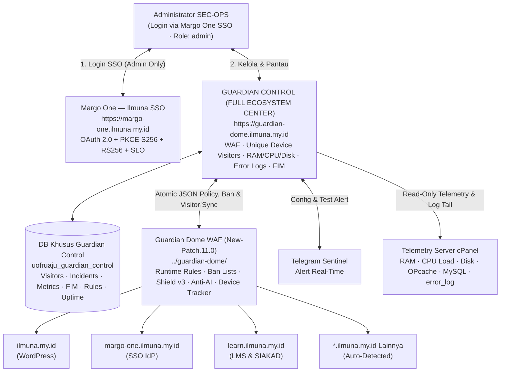

<div align="center">

  # 🛡️ GUARDIAN CONTROL — CYBER SEC-OPS & FULL ECOSYSTEM MONITORING CENTER
  ### Pusat Kendali Guardian Dome WAF, Keamanan Siber Zero-Trust, Telemetry Server & Analitik Pengunjung Unik (1 Device = 1 Visitor)
  **Monitoring Menyeluruh Seluruh Ekosistem Web `*.ilmuna.my.id` Tanpa Terkecuali (`ilmuna.my.id`, `margo-one.ilmuna.my.id`, `learn.ilmuna.my.id`, dll.)**

  <p align="center">
    <a href="https://php.net"></a>
    <a href="https://mysql.com"></a>
    <a href="#2-standar-paritas-tema-100-identik-lumina-gold--nusantara"></a>
    <a href="#3-autentikasi-eksklusif-margo-one-sso-admin-only"></a>
    <a href="#4-pilar-fitur-keamanan--monitoring-lengkap"></a>
    <a href="#23-filosofi-data-first-zero-page-reload--mobile-360px"></a>
  </p>

</div>

> **Single Source of Truth untuk Pembangunan Panel Kendali & Monitoring Ekosistem (`https://guardian-dome.ilmuna.my.id`)**  
> **Lokasi Engine Guardian Dome:** `../guardian-dome` (`/home/uofruaju/guardian-dome` di cPanel, fallback lokal `C:\laragon\Guardian Dome`).  
> **Prinsip Utama:** 100% **1 Tema (Lumina Gold & Sentuhan Nusantara)** identik dengan `learn.ilmuna.my.id` & `margo-one.ilmuna.my.id`, **1 Standar UI/UX** (Data-First, Zero Page Reload, `window.Ilmuna`, Solar Icons), **1 Pintu Masuk Admin via Margo One SSO**, dan **100% Kompatibel cPanel Shared Hosting (PHP 7.4 `ea-php74` s/d PHP 8.3 tanpa `exec()`/`shell_exec()`)**.

---

## 📑 DAFTAR ISI

1. [Visi & Posisi Guardian Control dalam Ekosistem Ilmuna](#1-visi--posisi-guardian-control-dalam-ekosistem-ilmuna)
2. [Standar Paritas Tema 100% Identik (Lumina Gold & Nusantara)](#2-standar-paritas-tema-100-identik-lumina-gold--nusantara)
3. [Autentikasi Eksklusif Margo One SSO (Admin-Only)](#3-autentikasi-eksklusif-margo-one-sso-admin-only)
4. [Pilar Fitur Keamanan & Monitoring Lengkap](#4-pilar-fitur-keamanan--monitoring-lengkap)
5. [Aset & Komponen Wajib yang Disalin 1:1 dari `SSO` & `learn`](#5-aset--komponen-wajib-yang-disalin-11-dari-sso--learn)
6. [Dokumen Pendamping (`BLUEPRINT.md` & `IMPLEMENTATION_PLAN.md`)](#6-dokumen-pendamping-blueprintmd--implementation_planmd)
7. [Prompt Starter Siap Pakai untuk Sesi Pembangunan Guardian Control](#7-prompt-starter-siap-pakai-untuk-sesi-pembangunan-guardian-control)

---

## 1. VISI & POSISI GUARDIAN CONTROL DALAM EKOSISTEM ILMUNA

**Guardian Control** (`https://guardian-dome.ilmuna.my.id`) bukan sekadar panel kontrol WAF, melainkan **Security Operations Center (SEC-OPS), Server Telemetry, dan Ecosystem Visitor Analytics Center** menyeluruh untuk **seluruh web di ekosistem `*.ilmuna.my.id` tanpa terkecuali**:
- **Guardian Dome WAF (`New-Patch.11.0`)** di `../guardian-dome/guardian-dome-waf.php` (`/home/uofruaju/guardian-dome/`)
- **Guardian Dome Telegram Sentinel** & **Cache Purger** (`../guardian-dome/`)
- **Seluruh Web Ekosistem `*.ilmuna.my.id`**: `ilmuna.my.id` (WordPress), `margo-one.ilmuna.my.id` (SSO IdP), `learn.ilmuna.my.id` (LMS & SIAKAD), `guardian-dome.ilmuna.my.id`, serta **otomatis mendeteksi subdomain baru apa pun** yang dilindungi Guardian Dome!
- **Unique Device Visitor Analytics (`1 Device = 1 Pengunjung`)**: Menghitung pengunjung manusia unik berbasis perangkat lintas seluruh web ekosistem (bukan hitungan refresh/pageviews berulang dari 1 perangkat yang sama, dan 100% bebas dari hitungan bot/crawler).



### Spesifikasi Teknologi Inti (WAJIB Identik dengan `SSO` & `learn`)

| Lapisan | Standar Wajib | Catatan Penting |
| :--- | :--- | :--- |
| **Backend** | **PHP Native** (**PHP 7.4 `ea-php74`** s/d **PHP 8.3**) | Tanpa framework (No Laravel/CI). **DILARANG** sintaks PHP 8-only (`match`, `?->`, union types, `readonly`, named args). |
| **Database** | **MySQL / MariaDB InnoDB** (`utf8mb4_unicode_ci`) via PDO Singleton | 100% Prepared Statements, `SET time_zone = '+07:00'`, Timezone PHP `Asia/Jakarta`. |
| **Telemetry cPanel** | **100% Native PHP** (`/proc/meminfo`, `sys_getloadavg`, `disk_*`, `opcache_get_status`, PDO `SHOW GLOBAL STATUS`) | **DILARANG bergantung pada `exec()` / `shell_exec()`** karena sering dinonaktifkan di cPanel shared hosting. |
| **Frontend** | **Vanilla ES6+ & CSS3 Variables** | Fetch API async, CSS Grid/Flexbox, grafik ringan Canvas/SVG native (tanpa React/Vue/jQuery/Bootstrap). |
| **Ikon Resmi** | **Iconify Solar Icons** (`solar:*-bold`, `solar:*-bold-duotone`, `solar:*-linear`) | CDN resmi: `https://code.iconify.design/iconify-icon/2.1.0/iconify-icon.min.js`. Dilarang campur icon pack lain. |
| **Alert & Dialog** | **`window.Ilmuna`** (`assets/js/alert.js`) | Dilarang keras `alert()`, `confirm()`, `prompt()`, SweetAlert, atau Toastr! |
| **Interaksi** | **Zero Page Reload** (Lazy Load On-Demand + In-Place DOM) | Mutasi aksi (Ban/Unban/Toggle Shield/Purge) via JSON API + animasi `.row-flash` / `.row-smooth-out`. |

---

## 2. STANDAR PARITAS TEMA 100% IDENTIK (LUMINA GOLD & NUSANTARA)

Guardian Control **wajib** memiliki 1 bahasa visual utuh dengan `margo-one.ilmuna.my.id` dan `learn.ilmuna.my.id` (bukan tema gelap hacker generik yang terpisah — tetap **Lumina Gold Light Canvas `#F8FAFC`** dengan kartu putih solid `#FFFFFF`, aksen Navy `#1D3B5E`, Teal `#0D7A87`, Sky `#52B2DC`, Gold `#F59E0B`, Emerald `#10B981`, Rose `#EF4444`, serta opsi Dark Mode `#0B1523` / `#102035` yang serasi).

### 2.1 Design Tokens CSS Resmi (`:root`)
```css
:root {
    /* Palet Inti Lumina Gold (100% Identik SSO & Learn) */
    --lumina-navy: #1D3B5E;
    --lumina-navy-dark: #13273F;
    --lumina-teal: #0D7A87;
    --lumina-teal-dark: #095963;
    --lumina-sky: #52B2DC;
    --lumina-sky-soft: #7CC5E5;
    --lumina-gold: #F59E0B;
    --lumina-amber: #D97706;
    --lumina-emerald: #10B981;
    --lumina-rose: #EF4444;

    /* Gradien Resmi */
    --lumina-gradient: linear-gradient(135deg, #1D3B5E 0%, #0D7A87 52%, #52B2DC 100%);
    --lumina-gradient-panel: linear-gradient(135deg, #1D3B5E 0%, #0D7A87 50%, #152C47 100%);

    /* Permukaan Light Mode (Solid Opaque) */
    --lumina-bg-canvas: #F8FAFC;
    --lumina-bg-light: #F4F8FA;
    --lumina-bg-card: #FFFFFF;
    --lumina-border: #E2E8F0;
    --lumina-border-subtle: #DEE7EE;
    --lumina-text-title: #0F1D2F;
    --lumina-text-body: #334155;
    --lumina-text-muted: #64748B;

    /* Tipografi Resmi */
    --font-heading: 'Outfit', -apple-system, BlinkMacSystemFont, 'Segoe UI', sans-serif;
    --font-body: 'Plus Jakarta Sans', -apple-system, BlinkMacSystemFont, 'Segoe UI', sans-serif;
    --font-mono: 'JetBrains Mono', 'Fira Code', Consolas, monospace;

    /* Radius & Elevasi */
    --radius-sm: 10px;
    --radius-md: 16px;
    --radius-lg: 24px;
    --radius-pill: 9999px;
    --shadow-card: 0 12px 32px -12px rgba(29, 59, 94, 0.14), 0 2px 8px rgba(29, 59, 94, 0.05);
}
```

### 2.2 Sentuhan Nusantara & Template Universal
- **Notifikasi & Konfirmasi (`window.Ilmuna`)**: Watermark `gunungan.png`, tekstur Batik Kawung 3%, sudut asimetris `32px 0 16px 0`, ornamen sudut SVG.
- **Universal Modal (`includes/modal-template.php`)**: `border-radius: 28px`, 3 bagian (Header, Body, Footer).
- **Universal Table (`includes/table-template.php`)**: `.lms-table.ilmuna-table-stack` dengan transformasi otomatis menjadi card stack di layar mobile.

### 2.3 Filosofi Data-First, Zero Page Reload & Mobile `360px+`
1. **Zero Page Title / Zero Hero Banner** di halaman operasional dashboard — langsung ke **Segmented Tabs** (`.curriculum-main-tabs`) dengan counter `.curriculum-tab-counter` dan toolbar aksi.
2. **Anti-Polling Boros**: Gunakan **Lazy Load On-Demand** + tombol **Segarkan** manual + pembaruan saat tab browser kembali aktif (`visibilitychange`), bukan `setInterval` agresif yang membebani shared hosting cPanel!
3. **Mobile-First `360px+`**: Zero `overflow-x`, touch target minimal `44px`, sidebar lipat mulus, dan tanpa banner pembuka yang memenuhi layar HP.

---

## 3. AUTENTIKASI WAJIB LOGIN (ADMIN-ONLY) & ISOLASI DATABASE TERPISAH

1. **Wajib Login & Eksklusif Role `admin`**:
   - Seluruh halaman dashboard dan endpoint `/api/*` di `https://guardian-dome.ilmuna.my.id` **wajib terautentikasi** (tanpa halaman publik).
   - Autentikasi utama menggunakan **Margo One SSO (`https://margo-one.ilmuna.my.id`)** dengan klien OAuth 2.0 + PKCE `S256` + JWT `RS256` (`client_slug: guardian-control`, `allowed_roles: admin`).
   - Mendukung **Back-Channel & Front-Channel Global Single Logout (SLO)** via `sso-logout-webhook.php` & `logout.php`.
   - Pengguna non-`admin` (Guru / Ketua Kelas / Siswa) yang mencoba mengakses langsung ditolak (`403 Forbidden`) dan dicatat ke `gc_admin_audit`.
   - Tersedia jalur darurat lokal terproteksi (`?emergency_admin=1` dengan kunci terenkripsi di `config.local.php`) khusus jika Margo One sedang maintenance.
2. **Database 100% Terpisah (Isolated DB)**:
   - Guardian Control menggunakan database MySQL **khusus dan terpisah total** (`uofruaju_guardian_control`) — **TIDAK digabung** dengan database Margo One SSO (`uofruaju_margo-one`) maupun Ilmuna Learn (`uofruaju_learn_ilmuna`).
   - Jika suatu saat DB aplikasi lain mengalami lonjakan trafik atau maintenance, Guardian Control tetap berdiri independen dan tetap bisa memantau status server/error log.

---

## 4. PILAR FITUR KEAMANAN & MONITORING LENGKAP

| # | Modul | Cakupan Fitur Utama |
| :-: | :--- | :--- |
| **1** | **WAF Command Center** | Status live **Guardian Dome `New-Patch.11.0`**, saklar toggle tiap modul shield (Pre-Flight Scan, Shield v3 Invisible CAPTCHA, Anti-AI Scraper, Honeypot Form, Strict Rate Limit, Under-Attack Mode), Emergency Unban 1-klik. |
| **2** | **IP Firewall & Subnet Manager** | Daftar IP/CIDR terblokir, Ban IP/Subnet `/24` manual, Unban 1-klik, Whitelist IP Admin/Sekolah, pencarian berdasarkan IP / Ray-ID / kategori serangan. |
| **3** | **Security Incident & Log Explorer** | Rekap real-time serangan SQLi, XSS, RCE, Shell, SSRF, OOB Collaborator, SSTI, CSRF, Credential Stuffing, Shield v3 Low-Score, Honeypot Trap; filter per subdomain & ekspor CSV/JSON. |
| **4** | **Server Telemetry (RAM, CPU, Disk, MySQL)** | Monitoring **RAM** (`/proc/meminfo` & PHP memory), **CPU Load Average** (1m/5m/15m), **Disk Space** & kuota direktori, **PHP OPcache**, **MySQL Health** (koneksi aktif, uptime, slow queries, ukuran DB `uofruaju_margo-one`, `uofruaju_learn_ilmuna`, WP), serta **HTTP Uptime Check** seluruh subdomain. |
| **5** | **Centralized Error Log Monitor** | Pembacaan aman (tail-read) `error_log` lintas aplikasi (`public_html`, `margo-one.ilmuna.my.id`, `learn.ilmuna.my.id`, `guardian-dome`), klasifikasi *Fatal / Exception / Warning / Deprecated*, tandai selesai, & rotasi log aman. |
| **6** | **Unique Device Visitor Analytics (`1 Device = 1`)** | Analitik pengunjung manusia unik **seluruh web ekosistem `*.ilmuna.my.id` tanpa terkecuali**: deduplikasi per perangkat (cookie lintas subdomain `.ilmuna.my.id` `gd_dev_id` + fingerprint hash), 1 device refresh berkali-kali tetap dihitung **1 pengunjung unik** (dipisah dari total pageviews), breakdown per subdomain, perangkat (Android/iOS/Desktop), browser, online aktif 5 menit terakhir, dan 100% bebas bot/crawler. |
| **7** | **AI Scraper & SEO/AdSense Inspector** | Monitor bot AI yang diblokir (ChatGPT/GPTBot, ClaudeBot, PerplexityBot, Bytespider, Google-Extended, dll.) vs crawler SEO/AdSense terverifikasi FCrDNS (Googlebot, Site Kit, AdSense, Bingbot). |
| **8** | **File Integrity Monitor (FIM)** | Baseline hash **SHA-256** untuk file kritis (`../guardian-dome/guardian-dome-waf.php`, `config.php`, `auth.php`, `.htaccess`), deteksi modifikasi tak sah & pemindaian file PHP mencurigakan di folder `uploads/` / `wp-content/uploads/`. |
| **9** | **Telegram Sentinel & Maintenance** | Pengaturan notifikasi Telegram Sentinel, uji kirim pesan, kontrol **Cache Purger** (rotasi 7 hari), serta log audit tindakan admin SEC-OPS. |

---

## 5. ASET & KOMPONEN WAJIB YANG DISALIN 1:1 DARI `SSO` & `learn`

| Kategori | Sumber | Tujuan di `guardian control` |
| :--- | :--- | :--- |
| **Alert & Dialog Nusantara** | `C:\laragon\www\SSO\assets\js\alert.js` | `assets/js/alert.js` |
| **CSS Shell & Responsive** | `C:\laragon\www\SSO\assets\css\margo-shell.css`, `lumina-lms.css`, `ilmuna-unified-responsive.css` | `assets/css/` |
| **Template Universal** | `C:\laragon\www\SSO\includes\modal-template.php`, `table-template.php`, `calendar-template.php` | `includes/` |
| **SSO Client SDK** | `C:\laragon\www\SSO\sdk\ilmuna-sso-client.php` | `sdk/ilmuna-sso-client.php` |
| **Aset Brand & Ornamen** | `C:\laragon\Guardian Dome\assets\Guardian_Dome.png`, `C:\laragon\www\SSO\assets\img\gunungan.png`, `logo.ico` | `assets/images/` & `assets/img/` |

---

## 6. DOKUMEN PENDAMPING (`BLUEPRINT.md` & `IMPLEMENTATION_PLAN.md`)

1. **[`BLUEPRINT.md`](BLUEPRINT.md)** — Arsitektur detail, jembatan atomik `gc-runtime-rules.json` ↔ Guardian Dome WAF, spesifikasi 8 modul, DDL lengkap 8 tabel `uofruaju_guardian_control`, desain API JSON, dan pohon struktur direktori.
2. **[`IMPLEMENTATION_PLAN.md`](IMPLEMENTATION_PLAN.md)** — Rencana pembangunan bertahap **Fase 0 s/d Fase 6**, daftar file per fase, checklist keamanan, 12 skenario pengujian, dan panduan deploy cPanel + registrasi klien di Margo One SSO.

---

## 7. PROMPT STARTER SIAP PAKAI UNTUK SESI PEMBANGUNAN GUARDIAN CONTROL

Saat Anda membuka folder **`C:\laragon\www\guardian control`** di sesi baru, cukup salin dan kirim prompt berikut:

```text
Bangun aplikasi Guardian Control (Pusat Kendali Guardian Dome WAF, Monitoring Menyeluruh Seluruh Web Ekosistem *.ilmuna.my.id, Server Telemetry & Analitik Pengunjung Unik 1-Device untuk https://guardian-dome.ilmuna.my.id) di workspace C:\laragon\www\guardian control.

WAJIB baca dan ikuti 100% seluruh spesifikasi, tahapan plan, desain, dan arsitektur dari berkas berikut sebelum menulis kode:
1. C:\laragon\www\guardian control\README.md (Standar Tema 100% Lumina Gold & Nusantara, Data-First, Zero Page Reload, Mobile 360px+)
2. C:\laragon\www\guardian control\BLUEPRINT.md (Arsitektur Lengkap, Path relatif ../guardian-dome, Bridge Atomik Guardian Dome Patch 11.0, 9 Modul SEC-OPS + Unique Device Visitor Analytics lintas semua web *.ilmuna.my.id + Server Monitoring RAM/CPU/Disk/MySQL/Error Logs/FIM, DDL Database uofruaju_guardian_control)
3. C:\laragon\www\guardian control\IMPLEMENTATION_PLAN.md (Rencana Implementasi Bertahap Fase 0 s/d Fase 6)

Referensi visual & SDK langsung agar 100% 1 tema dan 1 standar:
- C:\laragon\www\SSO\assets\css\margo-shell.css, lumina-lms.css, ilmuna-unified-responsive.css, assets\js\alert.js
- C:\laragon\www\SSO\sdk\ilmuna-sso-client.php & sso-callback.php (integrasi login Margo One SSO role admin-only + Global SLO)
- C:\laragon\Guardian Dome\guardian-dome-waf.php (New-Patch.11.0 — sumber file cache ban, threat_score, rdns_bot, dan integrasi gc-runtime-rules.json)

Ketentuan mutlak:
- 100% 1 tema Lumina Gold & Nusantara (palet #1D3B5E, #0D7A87, #52B2DC, #F59E0B, ikon eksklusif Iconify Solar Icons solar:*, dialog eksklusif window.Ilmuna — dilarang alert()/confirm()/SweetAlert/Bootstrap/jQuery).
- 100% kompatibel PHP 7.4 (ea-php74) hingga PHP 8.3 (tanpa sintaks PHP 8-only) dan cPanel shared hosting (telemetry RAM/CPU/Disk/MySQL/Error Log wajib native PHP tanpa bergantung pada exec()/shell_exec()).
- Kerjakan berurutan mengikuti Fase 0 sampai Fase 5 di IMPLEMENTATION_PLAN.md lalu jalankan php -l dan seluruh uji keamanan Fase 5 sebelum selesai.
```
